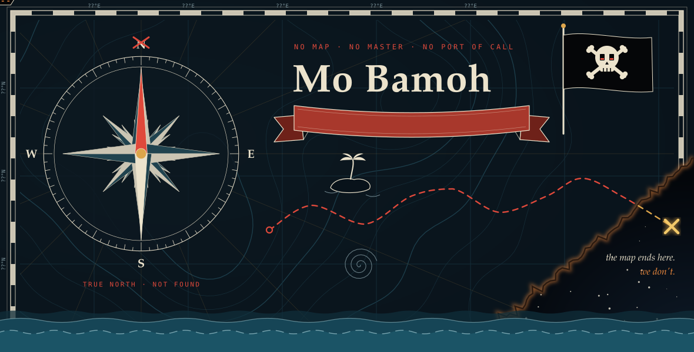
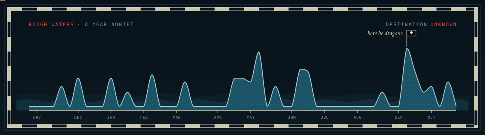

<a href="https://www.mohamedbamoh.com/">
  <picture>
    <source media="(prefers-color-scheme: dark)" srcset="./assets/chart-dark.svg">
    <source media="(prefers-color-scheme: light)" srcset="./assets/chart-light.svg">
    
  </picture>
</a>

<p align="center">
  <a href="https://www.mohamedbamoh.com/">🏴‍☠️ mohamedbamoh.com</a>
  &nbsp;·&nbsp;
  <a href="https://www.linkedin.com/in/mohamedbamoh/">⚓ LinkedIn</a>
  &nbsp;·&nbsp;
  <a href="mailto:me@mohamedbamoh.com">🍾 message in a bottle</a>
</p>

<picture>
  <source media="(prefers-color-scheme: dark)" srcset="./assets/sea-dark.svg">
  <source media="(prefers-color-scheme: light)" srcset="./assets/sea-light.svg">
  
</picture>

<br>

<details>
<summary><b>✕ marks the spot</b> — <i>dig here</i></summary>

<br>

```
        __________________
       / ~  ~  ~  ~  ~  ~ /|
      /__________________/ |
      |   .-----------.  | |
      |   |  *  *  *  |  | /
      |___'-----------'__|/
```

> *You found the buried chest. That makes you the curious kind too.*
>
> 🗝️ Inside: no gold — just an open invitation. Strange ideas, half-built maps,
> boats that probably shouldn't float. If you're sailing somewhere off the chart,
> send a bottle my way: **[me@mohamedbamoh.com](mailto:me@mohamedbamoh.com)**

</details>

<p align="center"><sub>— <i>Mo, somewhere past the edge of the map</i> · ⚓ fair winds, stranger</sub></p>
